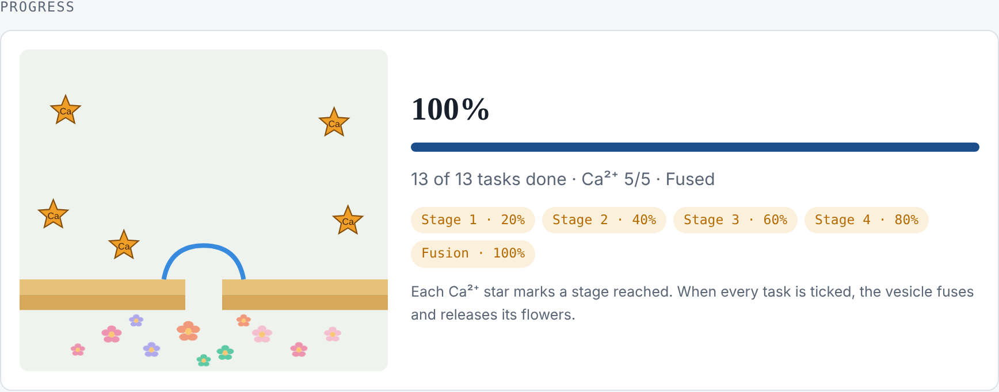

# PhD Finish Plan

A one-page planner for the last stretch of a PhD: the thesis, the paper that comes out of it, and everything in between. Every section is editable in the browser, and progress is drawn as a synaptic vesicle moving toward the membrane: each stage adds a Ca²⁺ star, and when every task is done the vesicle fuses and releases flowers.

## What's on the page

- **Key dates**: paper submission, decision gate, thesis to committee, defense
- **Progress**: vesicle-fusion tracker driven by the tasks you tick
- **The claim**: one sentence your work stands on, plus a working title
- **Results**: each thesis result, its figure, and where it goes in the paper
- **Writing plan**: thesis chapters, when to write them, and what the paper takes from each
- **Remaining work**: task groups you can add, rename, tick, and reorder
- **Timeline**: milestones and decision points
- **Journal ladder**: where to send the paper, in order
- **Submission package** and **risks**

## Use it

### On GitHub Pages

1. Fork or copy this repository.
2. Settings → Pages → deploy from the `main` branch, root folder.
3. Open the site, click **Edit page**, change anything, and **Save changes**.

Edits and ticks are saved in your browser. To keep them in the repository, click **Download page** and replace `index.html` with the downloaded file, then commit.

### As a file on your computer

Download `index.html` and open it in a browser. It works offline the same way: edits stay in that browser until you download an updated copy.

### On claude.ai

Published as an Artifact with the page-save capability, the page saves itself: edits and ticks become a new version, and progress is the same on every device.

## Privacy

GitHub Pages sites on personal accounts are public, even when the repository is private. Keep unpublished results, data, and manuscript details out of a public copy. Use a private Artifact or a local file for the real plan, and keep this repository as the template.

## How it's built

A single HTML file with no build step. The page state lives in a JSON block inside the file; the script renders every section from it and writes it back when you save. Fonts load from Google Fonts; nothing else is fetched.

Designed by Tanakan Paladkong and built with Claude (Anthropic).

## License

MIT. See [LICENSE](LICENSE).
